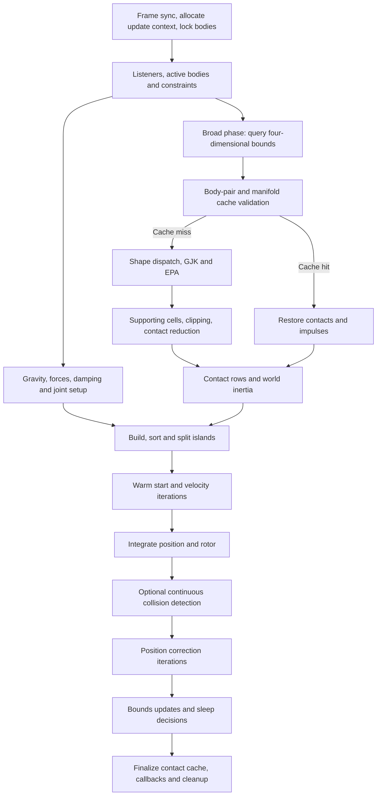

# 4D step-performance investigation

Investigation baseline: `c9014297` on the local WSL `4d` branch, which was then 27 commits ahead of the public branch. Upstream 3D baseline: `6576239ada52ff3bc3332eadeae94c1f5e491637` (`master`, Jolt 5.5.1). The old public `4d` head was not the working v1 and was not used for the comparison. This report and the retained changes are now included with the published 4D work.

The tables below describe the contact-heavy pyramid workload, not capacity for a space-combat game. See the proposed [space-sim specification](SpaceSimSpecification.md) and [architecture](SpaceSimArchitecture.md) for representative workloads and integration requirements. Machine-readable summaries and failure inputs are tracked; raw logs, CSVs and binaries referenced below are local artifacts and are not included in Git.

## Third pass: additional solver gain and native Windows measurements

**The full-workload reliability target remains unmet.** Native Windows reaches 154–157 steps/s on average at actual 120 Hz, but including the initial collapse exposes roughly 14 ms p99 steps and only about 91% of updates within 8.333 ms. Its settled phase is much faster. The initial collision burst matters for interaction-heavy gameplay and must not be hidden by warmup exclusion.

The retained change skips friction work only when the friction cone radius is exactly zero **and all three accumulated tangent impulses are already zero**. A nonzero cached friction impulse still runs through the solver so it can be removed. Normal solving, contact counts, iteration counts, tolerances and sleeping settings are unchanged. The 600-update state hash remains `0xad587f699b3a4e91` across tested thread counts and platforms.

### Unchanged 60 Hz workload

Five interleaved repetitions, 600 updates, first 100 excluded only for deadline statistics. The previous binary and the new shortcut are in the same batch. Tables show medians of per-run statistics unless a single run is stated. All runs, including slow ones, are retained.

| Build / threads | Whole-run steps/s | p95 ms | p99 ms | Within 120 Hz budget | Within 150 Hz budget |
|---|---:|---:|---:|---:|---:|
| WSL 3D, 6 threads | 315.2 | 3.64 | 3.97 | 100.0% | 100.0% |
| WSL previous 4D, 6 threads | 98.5 | 12.24 | 14.12 | 57.0% | 0.0% |
| WSL retained 4D, 6 threads | 105.9 | 11.56 | 13.17 | 61.0% | 9.0% |
| WSL 3D, 12 threads | 299.0 | 4.89 | 7.28 | 99.2% | 98.6% |
| WSL previous 4D, 12 threads | 105.6 | 14.36 | 17.63 | 52.6% | 19.4% |
| WSL retained 4D, 12 threads | 118.2 | 10.51 | 13.60 | 70.4% | 32.6% |

This gives a further 7.5% / 11.9% median improvement at six / twelve threads in that batch. It does not establish a reliable 120 Hz deadline at the original timestep. The native MSVC comparison used three repetitions and matching settings for native 3D and 4D:

| Build / threads | Whole-run steps/s | p95 ms | p99 ms | Within 120 Hz budget | Within 150 Hz budget |
|---|---:|---:|---:|---:|---:|
| Native 3D, 6 threads | 333.6 | 3.36 | 3.52 | 100.0% | 100.0% |
| Native 4D, 6 threads | 106.6 | 11.37 | 12.65 | 63.2% | 0.0% |
| Native 3D, 12 threads | 396.9 | 2.85 | 2.99 | 100.0% | 100.0% |
| Native 4D, 12 threads | 138.9 | 8.48 | 9.16 | 94.6% | 63.0% |

Native and WSL use different compilers as well as different execution environments, so the difference cannot be assigned solely to WSL overhead. Native 4D is an experimental build with the pre-existing geometry-test failure described below.

### Actual 120 Hz and 150 Hz integration

These are separate workloads, not replacements for the unchanged-timestep comparison above. Every run simulates ten seconds: 1200 updates at 120 Hz (200 warmup updates), or 1500 at 150 Hz (250 warmup updates). Three repetitions at each thread count; whole-run throughput includes startup. Smaller timesteps change contact/cache behavior. The physics tests also exercise identical simulated durations and unchanged accuracy bounds at 60, 120 and 150 Hz.

| Integration / build / threads | Whole-run steps/s | p95 ms | p99 ms | Within 120 Hz budget | Within 150 Hz budget |
|---|---:|---:|---:|---:|---:|
| 120 Hz / WSL / 6 | 128.0 | 9.33 | 10.00 | 85.0% | 58.2% |
| 120 Hz / Native / 6 | 124.0 | 9.48 | 10.06 | 81.6% | 33.6% |
| 120 Hz / WSL / 12 | 134.6 | 9.21 | 13.95 | 90.8% | 62.7% |
| 120 Hz / Native / 12 | 155.6 | 7.36 | 7.84 | 99.8% | 80.6% |
| 150 Hz / WSL / 6 | 132.0 | 8.04 | 9.19 | 96.0% | 66.0% |
| 150 Hz / Native / 6 | 131.3 | 8.23 | 9.13 | 95.8% | 50.2% |
| 150 Hz / WSL / 12 | 142.0 | 9.15 | 11.86 | 92.8% | 71.0% |
| 150 Hz / Native / 12 | 164.6 | 6.37 | 7.21 | 100.0% | 97.1% |

A longer check simulates 30 seconds at 120 Hz, with 3600 updates and twelve threads (one run each):

| Build | Whole-run steps/s | p95 ms | p99 ms | Within 120 Hz budget | Within 150 Hz budget |
|---|---:|---:|---:|---:|---:|
| WSL | 147.0 | 9.46 | 13.37 | 90.9% | 69.4% |
| Native | 170.3 | 6.98 | 8.24 | 99.1% | 94.2% |

The p95, p99 and budget percentages above exclude the stated warmup; throughput always includes every update. For acceptance, the following twelve-thread measurements include **every update**, including the initial collapse:

| Integration / build / duration | Whole-run steps/s | Full-run p95 ms | Full-run p99 ms | Within 120 Hz budget | Within 150 Hz budget |
|---|---:|---:|---:|---:|---:|
| 120 Hz / WSL / 10 s | 134.6 | 12.31 | 17.41 | 80.0% | 55.2% |
| 120 Hz / Native / 10 s | 155.6 | 10.11 | 14.09 | 91.2% | 70.3% |
| 150 Hz / WSL / 10 s | 142.0 | 11.49 | 17.12 | 83.6% | 61.6% |
| 150 Hz / Native / 10 s | 164.6 | 9.32 | 13.79 | 92.1% | 84.6% |
| 120 Hz / WSL / 30 s | 147.0 | 10.35 | 15.00 | 87.8% | 66.6% |
| 120 Hz / Native / 30 s | 170.3 | 8.24 | 11.83 | 95.2% | 90.0% |

Averages above 150 steps/s do not establish a 150 Hz deadline. Use the per-step columns, not the best average. These are headless pyramid measurements on this desktop, not a guarantee for arbitrary game scenes. All final runs check update errors, finite transforms and repeatable state hashes.

### Validation and an existing accuracy gap

- Final WSL Release and assertions-enabled ASAN/UBSAN: **389 cases / 2,397,320 assertions, all passed**. HelloWorld passes in both builds.
- Expanded independent Clifford-algebra checks cover 1000 rotor/vector-matrix samples and 1000 bivector rotations. Whole-body pyramid stability and collision momentum/energy checks now run at 60, 120 and 150 Hz with unchanged tolerances.
- Native MSVC: **389 of 390 cases passed**, with one failure in `TestGJKSphereVsBoxIntersect`; HelloWorld passed. The native random input exposed a raw GJK false negative for a sphere overlapping an axis-aligned box by about **0.10595**. This exceeds the existing 0.05 test bound. Replaying its exact float bits under GCC reproduces the miss in both the retained engine and the **untouched v1 `c9014297`**. It is not caused by the friction shortcut or the native compiler. The Linux random suite simply does not cover that input. No tolerance was relaxed.
- The failing input bits and build hashes are recorded in `PerformanceOptimizationResults.json` under `round3.known_gjk_failure`; logs and the standalone reproducer are in `Build/perf-results/gjk_native_case.*`, `gjk-native-case-linux.log`, and `native-gjk-diagnostic.log`. Treat native timing success separately from full correctness acceptance. A dedicated robust-simplex fix remains necessary; this investigation does not prove every game collision path is unaffected.
- Native compilation required explicit AVX vector/rotor/body alignment, unambiguous brace initialization of DOF masks, and explicit enum labels for the already-unsupported object-stream skip cases. These preserve the existing storage alignment and behavior. No fast-math option was added.

### Experiments rejected in this pass

| Experiment | Outcome |
|---|---|
| Explicit six-float loads; padded eight-float response storage | No repeatable improvement; padding increased solver traffic. Reverted. |
| Spin(4) adjoint rotation, explicit quadratic rotation matrix, direct position-row inertia action | Independent reference tests passed; whole-scene timing gains did not justify retaining the alternative math. Reverted. |
| Cached contact normal as the GJK initial direction | Correctness suite passed, but contaminated/noisy measurements did not establish a gain. Reverted. |
| Denormal flushing in the velocity solver | No dependable gain. Original floating-point behavior retained. |
| Three-tangent friction storage block | Bit-identical benchmark state, but no meaningful measured gain. Reverted. |
| Paired AVX body-point contractions | Bit-identical reference tests and scene hash; negligible/no dependable gain. Reverted. |
| Profile-guided compilation | Trained at 60/120 Hz and tested at 60/120/150 Hz. Small changes at 60 Hz, essentially no six-thread gain at higher frequencies; not made a build requirement. |
| Stored normal Jacobians | More storage without a consistent speedup. Reverted. |
| Per-body inertia cache before collision setup | Bit-identical scene hash and full WSL suite passed; about 2–3% in repeated native 120 Hz runs, with expensive startup steps still over budget. Adds allocation and precomputation even for contact-free bodies; not retained. |

The new sample profile still concentrates on velocity solving (~43% exclusive samples) and EPA expansion (~11%). Coarse WSL sampling is qualitative, not a precise CPU-time budget. Broad phase, integration and island scheduling remain smaller contributors. The remaining substantial performance work is a contact layout/solver that batches independent constraints, plus robust collision math; it needs ordering, friction, momentum and determinism validation. Merely cutting solver iterations or manifold points would evade the requested physics-quality constraint.

### Reproducing the native build

Tested with Visual Studio 2026 / MSVC 19.50.35721 and its bundled CMake. Run from a developer shell:

```powershell
cmake -S Build -B Build/perf-native -G "Visual Studio 18 2026" -A x64 `
  -DDEBUG_RENDERER_IN_DEBUG_AND_RELEASE=OFF -DPROFILER_IN_DEBUG_AND_RELEASE=OFF `
  -DTARGET_SAMPLES=OFF -DTARGET_VIEWER=OFF -DTARGET_PERFORMANCE_TEST=ON `
  -DTARGET_UNIT_TESTS=ON -DTARGET_HELLO_WORLD=ON -DGENERATE_DEBUG_SYMBOLS=OFF `
  -DOVERRIDE_CXX_FLAGS=OFF "-DCMAKE_CXX_FLAGS_RELEASE=/GS- /Gy /O2 /Oi /Ot /fp:precise" `
  "-DCMAKE_CXX_FLAGS=/wd4866 /wd4868"
cmake --build Build/perf-native --config Release --target UnitTests PerformanceTest HelloWorld
Build/perf-native/Release/PerformanceTest.exe -s=Pyramid -q=Discrete -t=12 -i=1200 -hz=120 -f
```

The two disabled diagnostics concern MSVC evaluation-order warnings in existing pure expressions and doctest comparisons; warnings-as-errors otherwise remains enabled. Release uses `/fp:precise`, AVX2 and LTCG. Debug symbols were disabled after an installed PDB-manager error. The precise-arithmetic setting must be retained when reproducing these results.

Earlier batches were affected by host load, including Edge using about two cores. After the user freed the CPU, comparisons were rerun; monitor logs retain all samples. Monitoring visible Windows processes does not prove complete host isolation. No outlier was silently removed.

## Historical second-pass result


The previous 85-step result was affected by other CPU work. It is kept below as historical data, not used as the baseline for this pass. The fresh comparison interleaves all four binaries, with **five repetitions of 600 updates at six and twelve threads**. The one-thread check has one repetition. Throughput is whole-run steps/s; p95 is measured after the first 100 updates and then medianed across runs. Every run is retained.

| Threads | 3D | Untouched 4D | Previous optimization | Current 4D | Current p95 |
|---:|---:|---:|---:|---:|---:|
| 1 (one run) | 105.6 | 14.6 | 21.8 | 24.5 | 49.34 ms |
| 6 | 333.1 | 60.8 | 95.3 | 103.8 | 11.50 ms |
| 12 | 327.9 | 67.0 | 108.7 | 118.1 | 10.32 ms |

**A reliable 120-step/s budget is still not achieved.** Averages and frame-time deadlines are different: the p95 values above exceed 8.333 ms. No contact limit, iteration count, sleep setting, timestep or scene size was reduced to improve the numbers. These remain shared-desktop measurements; resuming the work does not guarantee an isolated CPU, and variations remain visible in both 3D and 4D results.

At 6 threads, current throughput ranges from 102.6 to 105.2; the median improves 9.0% over the previous optimization in this same batch. The median run has 62.4% of post-warmup steps within 8.333 ms. At 12 threads, current throughput ranges from 108.7 to 122.7; the median improves 8.6% over the previous optimization in this same batch. The median run has 72.0% of post-warmup steps within 8.333 ms.

The additional 1800-update runs measured **125.2 / 138.7 steps/s** at six / twelve threads, with p95 **10.12 / 9.35 ms**. Both completed without update errors or non-finite final transforms, and their final hashes matched. The current 600-update hash is `0xad587f699b3a4e91`, matching across one, six and twelve threads and every repetition. Different source revisions are not expected to share hashes.

Validation: Release **389 cases / 2,384,270 assertions**, and assertions-enabled AddressSanitizer + UndefinedBehaviorSanitizer **389 cases / 2,384,270 assertions**, all passed. HelloWorld passed in both builds. AVX-512 was tested only in the earlier pass; there is no claim that the new revision has been validated with it.

Current summaries, all experimental runs, final source hashes and binary hashes are recorded in [PerformanceOptimizationResults.json](PerformanceOptimizationResults.json). Raw CSVs and logs are under WSL `build/perf-results/round2-final-*` and the Windows mirror `Build/perf-results/round2-final-*`.

### Changes retained in the second pass

- **Friction frame:** use the continuous tangent frame available on the unit 3-sphere. Three signed vector permutations replace repeated Gram–Schmidt normalization and avoid abrupt changes of tangent direction near coordinate axes. The generic geometry basis remains unchanged: replacing it globally broke an EPA accuracy test and was rejected. New tests check orthogonality and continuity.
- **Dot products:** replace the x86 DPPS instruction with explicit SIMD multiplication and pairwise addition, keeping `(x+y)+(z+w)` rounding order. A 10,000-case reference test covers scalar and replicated results.
- **EPA connectivity:** use the known simplex adjacency for initialization; store horizon ridge keys contiguously as 32-bit integers and scan four at a time. A test checks reciprocal links and shared vertex sets through all 120 seed permutations and repeated hull expansions.
- **EPA cell work and storage:** skip barycentric projection for positive-distance cells already excluded by the current queue bound. Preserve origin-facing cells and defined data; independent winding/bound tests cover this distinction. Narrow bounded indices and reorder fields to reduce the cell from 128 to 96 bytes, without reducing cell or vertex capacities.
- **Contact rows:** remove unused spring softness from contact-only rows (general joint rows retain it), reducing each contact row from 68 to 64 bytes. A six-point constraint is now 1896 bytes versus 4192 originally. Evaluate the three friction velocity projections together while preserving sequential impulse application and the normal solve order.
- **GJK tetrahedra:** defer the interior projection until the outside-face tests establish it is needed; exterior queries no longer solve a Gram system whose answer would be overwritten. Existing geometry tests and additional known-barycentric simplex tests pass.

A profile during this pass still identified velocity solving (32.2% exclusive samples) and EPA expansion (18.1%) as the two largest individual hotspots. New-contact setup was 7.3%, position solving 6.8%, clipping 4.9%, cached row setup 3.9%, and body transforms 2.0%. This was taken before the last EPA packing/bound changes and is a hotspot guide, not a precise final stage-time accounting. Inlining and coarse WSL sampling limit attribution.

### Additional experiments rejected

| Experiment | Result |
|---|---|
| Per-body world-inertia cache | Passed the tests, but negligible gain did not justify extra storage, validity checks and preparation work. |
| Store the normal angular Jacobian separately | No useful throughput improvement; worse frame-time tails. |
| Combine the three friction impulse updates | Passed tests; the resumed repeated comparison did not establish a six-thread gain. |
| Direct 4×4 pentachoron solve | Passed independent geometry tests; slower at twelve threads in the repeated comparison. Retained the original robust formulation. |
| Sparse box SAT plus GJK witnesses | Passed tests but did not outperform the optimized generic path. |
| SAT plus alternating-projection witnesses | Slower at six and twelve threads; reverted. |
| Explicit fused solver updates | Passed tests; no clear throughput gain and worse six-thread p95. |
| Compact isotropic velocity solver | Passed all 388 tests available at that point, but repeated timings did not justify extra per-contact storage and another solver path. Reverted. |

These experiments and their source/binary snapshots are retained under `build/perf-results` for inspection, but are absent from the engine's retained implementation. No failing accuracy tolerance was relaxed to keep an optimization.

## Historical first-pass measurement

**AVX2: 93.8 steps/s at twelve threads, up from 55.2 (1.70×). The 120 steps/s target is not reached.** Six threads provide a more consistent 85–89 steps/s on this shared desktop. The original scene, six-contact limit and solver iteration counts are unchanged.

Whole-run throughput below is the median of three 600-update runs, except the one-thread row, which has one run. p95 is the median of each run's frame-time p95 after excluding its first 100 updates.

| Threads | Upstream 3D steps/s | 4D before steps/s | 4D after steps/s | 4D speedup | 4D p95 before → after |
|---:|---:|---:|---:|---:|---:|
| 1 (one run) | 104.6 | 13.4 | 19.9 | 1.49× | 98.96 → 63.07 ms |
| 6 | 321.3 | 54.8 | 85.4 | 1.56× | 23.54 → 15.11 ms |
| 12 | 298.8 | 55.2 | 93.8 | 1.70× | 24.63 → 15.59 ms |

The twelve-thread optimized runs ranged from 77.1 to 95.3 steps/s. Host-load outliers also affected upstream 3D (175.2–305.8 at twelve threads). These are shared-desktop measurements, not isolated bare-metal laboratory results. The runner retains all runs; none were discarded. Optimized steady throughput was 96.1 / 99.4 steps/s at six / twelve threads, but only 29.8% / 33.2% of steady frames met 8.333 ms. A best run or settling phase must not be presented as a sustained 120-step result.

The final transform hashes match across all tested thread counts and repetitions within each build: upstream `0xfa83740df6341495`, baseline 4D `0x9a73c11604a0688d`, optimized 4D `0x9690ed7463640ef0` (600 updates). Raw run summaries and source checksums are in [PerformanceOptimizationResults.json](PerformanceOptimizationResults.json); frame CSVs and logs remain under WSL `build/perf-results/retained-comparison` and `retained-single-thread`.

An additional matched build experiment enabled `USE_AVX512=ON` on this supported CPU, for both 3D and 4D. In that interleaved batch, optimized 4D medians were 88.5 → 82.1 steps/s at six threads and 91.9 → 95.7 at twelve threads (AVX2 → AVX-512). Upstream 3D measured 321.3 → 322.2 and 285.1 → 314.5 respectively. AVX-512 passed all tests and produced the same final hashes, but did not close the gap or give a consistent 4D improvement. The default remains AVX2; the optional build is retained under `build/perf-avx512` for further experiments.

A final 1800-update check (30 seconds of simulated time, one run per thread count) completed with finite transforms, no update errors, and matching final hashes at six and twelve threads. Whole-run throughput was **96.7 / 100.6 steps/s**, with steady p95 **13.87 / 17.09 ms**. Even this longer settling workload did not reach 120. This is a runtime / determinism check, not an independent proof of every contact's physical accuracy.

## Workload and measurement

- AMD Ryzen 5 9600X, six physical cores / twelve logical processors, WSL2 Linux 6.6.87.2, GCC 13.3.0, Release (`-O3 -ffp-contract=off`), AVX2, LTO enabled. Compiler definitions and flags matched between 3D and 4D.
- Headless `Pyramid`: 1296 dynamic 4D boxes versus 1240 upstream 3D boxes. Same box size, vertical gap, zero convex radius, disabled sleeping, ten velocity iterations and two position iterations. This compares similarly sized native scenes, not identical contact graphs: a 4D contact patch is a volume and has three friction directions.
- Discrete collision detection, one collision substep, simulation timestep **1/60 s**. Throughput of 120 steps/s means finishing each update within **8.333 ms**; it does not establish stability with a 1/120 s timestep.
- Profiler and debug renderer disabled in timed builds. Sampling is performed separately. No compilation runs concurrently with reported benchmarks.
- Current comparisons use 600 updates and five repetitions (the historical first pass used three), and exclude the first 100 updates only for the per-frame steady statistics. Whole-run throughput includes every update. Timed runs alternate 3D / baseline / optimized to reduce host-load bias.
- `PerformanceTest/run_comparison.py` saves every frame time and checks final transform hashes across repetitions and thread counts within each binary. The benchmark now fails on update-capacity errors or non-finite final transforms. Hash agreement checks repeatability, not physical correctness; regression tests cover the latter.

The original reported 20 FPS was not reproduced as a render benchmark. The working WSL version already contained earlier performance improvements. Short 200-update baseline runs measured about 43–44 steps/s with six threads and 10 steps/s with one thread. All speedup claims here are relative to the untouched WSL baseline, not relative to 20 FPS.

## Step map

The following is the dependency flow for a rigid-body update; independent jobs overlap, so it is not a list of serial elapsed-time slices.



| Stage | Main implementation | Investigation / action |
|---|---|---|
| Entry, allocation, scheduling | `PhysicsSystem::Update`, `PhysicsUpdateContext`, job system | Reviewed dependencies and fast exit. No evidence that setup dominates this scene. |
| Listeners, gravity, damping | `JobStepListeners`, `JobApplyGravity`, `MotionProperties` | Linear in active bodies; small sampled contribution. Kept physics settings unchanged. |
| Broad phase | `JobFindCollisions`, `QuadTree::FindCollidingPairs` | About 1.5% exclusive baseline samples. Fixed the 160-byte free-list stride that violated 64-byte node alignment; use 192-byte slots. |
| Pair filtering and cache | `ProcessBodyPair`, `GetContactsFromCache` | Fixed missing third friction warm start. Tested 2 mm and 4 mm cache thresholds; results did not justify changing the 1 mm default. |
| GJK / EPA | `ConvexShape::sCollideConvexVsConvex`, `EPAPenetrationDepth`, `EPAConvexHullBuilder` | Replaced redundant full 4D OBB SAT rejection with conservative transformed AABBs; retain exact narrow-phase tests. Vectorized cross products and grouped EPA barycentric divisions. The second pass adds SIMD ridge matching, compact cells, bounded projection work and deferred tetrahedron projection. |
| Manifold generation | `ManifoldBetweenTwoFaces`, `ClipPolytopeVsPolytope`, `GetClipHalfSpaces`, `PruneContactPoints` | Added verified binary-cell topology path: six facets instead of enumerating 56 candidate triples. Unordered, degenerate and poorly conditioned inputs retain the generic path. Existing edge clipping / reduction preserved. |
| Contact setup / inertia | `TemplatedAddContactConstraint`, `CalculateFrictionAndNonPenetrationConstraintProperties`, `GetInverseInertiaForRotation` | Removed matrix-to-rotor round trips. Fixed world-space DOF masking of the inertia operator. An isotropic-inertia shortcut did not provide a repeatable gain and was removed. |
| Islands, sorting, batching | `IslandBuilder`, `LargeIslandSplitter`, `JobFinalizeIslands` | Tested batches of 8, 16 and 32 constraints. Retained 16; alternative sizes did not consistently improve throughput. Sorting and deterministic solve order retained. |
| Warm start / velocity solve | `WarmStartVelocityConstraints`, `SolveVelocityConstraints`, `AxisConstraintPart` | Largest individual sampled function. Pack six physical bivector components; contact rows share lever arms and compute one relative point velocity for the three friction directions. Recompute normal-row velocity after preceding impulses. Keep the two bodies' velocities local during a manifold solve, then write back; preserve the impulse and DOF-mask operation order. |
| Integration / CCD | `JobIntegrateVelocity`, `JobFindCCDContacts`, `JobResolveCCDContacts` | Reviewed rotor and motion flow. Discrete Pyramid does not exercise meaningful CCD workload, so no CCD speedup claim. |
| Position solve | `JobSolvePositionConstraints`, `SolvePositionConstraints`, `Body::AddRotationStep` | Retains nonlinear position correction, recalculated lever arms and the original iteration count. Benefits from compact row storage and shared math improvements. |
| Bounds, sleep, cache finalization | `CheckSleepAndUpdateBounds`, `FinalizeContactCacheAndCallContactPointRemovedCallbacks` | Bounds and cache remain updated every step. Sleeping is disabled for the test, so no gain comes from silently deactivating the scene. |
| Soft-body jobs | `JobSoftBodyPrepare/Collide/Simulate/Finalize` | Present in the inherited job graph but outside the supported rigid-body v1 workload and this comparison. |

## Why the port is slow

The extra dimension has intrinsic costs: six angular components instead of three, three friction rows instead of two, larger contact patches, and tetrahedral EPA hull cells instead of triangles. That alone does not explain the full slowdown. The port also streams oversized solver rows and repeats general geometry work for box cells with known topology.

A separate single-thread, 200-update `gprofng` sample of the unchanged baseline found these approximate **exclusive** shares:

| Function / region | Baseline samples |
|---|---:|
| Contact velocity solve | 27.7% |
| EPA hull expansion (`AddPoint`) | 13.1% |
| Supporting-cell halfspace construction | 8.3% |
| Convex collision function, excluding callees | 7.3% |
| Polytope segment clipping | 6.8% |
| New-contact setup, dynamic/dynamic | 5.8% |
| Body center-of-mass transform | 3.4% |
| Cached contact-row setup | 2.9% |
| Position solver, excluding callees | 2.4% |
| Broad-phase pair query, excluding callees | 1.5% |

Inlining and coarse sampling limit attribution. WSL sampling reported fewer CPU seconds than wall time, so these are hotspot proportions, not a precise stage-time accounting. Inclusive samples overlap and must not be summed. Broad-phase replacement or job-system microtuning cannot plausibly deliver the missing factor on its own.

Older project notes identify the incorrect Morton bit spreading as a possible performance problem. Source search found no callers of `MortonCode` in this revision's engine; it cannot explain this Pyramid result. It remains a separate correctness issue for future users of that utility.

A second profile after compact/factored rows, cell facets, SIMD cross products and alignment repair found velocity solving at 33.1%, EPA expansion at 17.9%, clipping at 7.6%, and halfspace construction at 2.1%. The sample was taken before the final bivector SIMD and local-velocity changes. A larger percentage does not imply a regression: the total sampled work fell and other regions became cheaper.

The retained bivector wedge and contraction operations now use lane shuffles and vector arithmetic instead of extracting individual scalar components. Their independent Clifford-algebra reference tests were expanded to 1000 cases each. Measured with the actual build flags: the original general solver row was 160 bytes, the packed general row is 112 bytes, and the current compact contact row is 64 bytes. A full six-point contact constraint shrank from **4192 to 1896 bytes (54.8%)**, without removing contact points.

## Experiments rejected

| Experiment | Reason for not retaining it |
|---|---|
| Larger body-pair cache movement tolerance (2 / 4 mm) | No consistent gain; would also alter contact refresh behavior. |
| Isotropic-inertia setup special case | Additional mode / branching did not yield a repeatable end-to-end improvement. |
| Constraint batches of 8 or 32 | Original batch size 16 performed at least as well across runs. |
| Sorting EPA ridge keys | Sorting overhead outweighed the avoided scans for typical small horizons. |
| Open-addressed EPA ridge lookup | Similar or worse measured throughput; reverted. |
| Box-only SAT penetration with GJK surface witnesses | Passed the existing physics suite but did not give a decisive speedup over the optimized general path. Reverted rather than adding a second penetration implementation for a marginal result. |

These experiments are separate from the retained conservative AABB rejection filter. That filter only avoids an expensive pretest; GJK/EPA still make the collision decision.

## Correctness fixes and safeguards

1. Cached contacts restored only two of the three friction impulses. A regression fails on the baseline for the omitted tangent, then passes after restoring `mFrictionLambda[2]`. It exercises every tangential axis with caching on and off.
2. The dense inverse-inertia path applied world DOF locks to the principal-frame diagonal. With a rotated anisotropic body those are different bases. Reference tests compare the assembled operator against the original rotor-based multiplication, including locked DOFs and inertia scaling; locks now mask the assembled world rows and columns.
3. Extending the broad-phase node with W bounds changed the free-list slot from 128 to 160 bytes. The allocator aligns page starts, but every second node then violated the cache-line assertion. Padding the slot to 192 bytes restores alignment without weakening the assertion. Assertions plus AddressSanitizer and UndefinedBehaviorSanitizer exposed this issue.
4. Cross-product tests compare against independently evaluated double-precision determinants. Cell-facet tests compare the fast path with generic enumeration. Factored contact-row tests compare impulses against stored angular-Jacobian rows on rotated, anisotropic dynamic bodies.

The solver preserves contact limits, friction-cone clamping, friction-before-normal ordering, restitution settings, cache thresholds and iteration counts. Algebraic refactoring and the correctness fixes change final floating-point trajectories, so the optimized hash is expected to differ from the baseline hash. Within-build determinism is checked separately.

Historical first-pass validation: **384 test cases, 172,031 assertions passed**, both in the normal Release build and with assertions, AddressSanitizer and UndefinedBehaviorSanitizer enabled. The 4D HelloWorld smoke test also passed in both builds. The separate AVX-512 Release build passed the same tests. These runs validate Linux x86-64 single precision; they do not establish cross-platform bitwise determinism, ARM performance, double precision, renderer performance, or the still-disabled legacy 3D test suites.

## Remaining path to 120 steps/s

The measured target remains unmet. Further gains need changes to the two dominant workloads, followed by the same correctness and frame-time gates:

1. **Contact solving:** the second pass now projects the three tangential velocities together. Grouped impulse updates and a compact isotropic path were tested and rejected; a more substantial joint layout for all three rows remains an option. The present changes already remove redundant angular Jacobians and repeated body writes. A more extensive data layout change should be justified with instruction / cache measurements, and preserve the sequential normal solve and Coulomb cone.
2. **Narrow-phase persistence:** reuse validated separating directions or support features when a body pair moves beyond the full-manifold cache threshold. This can reduce GJK/EPA work without accepting stale contact geometry. Simply increasing the cache tolerance did not demonstrate the required gain.
3. **Box contact geometry:** a dedicated path needs to produce both penetration and valid contact witnesses cheaply. The SAT-plus-GJK prototype duplicated enough work to erase its benefit. A topology-aware box manifold implementation is a larger change and needs independent rotated/scaled-box and long-stack tests before replacing the general solver.
4. **Reassess scheduling after those costs fall:** batch-size tuning alone did not help. Broad phase, integration, sorting and finalization were reviewed and are small contributors in this workload; optimizing a 1–3% stage cannot close the remaining gap by itself.

No setting was changed to hide cost by reducing contacts, solver iterations, scene size or simulation activity. A future acceptance run should repeat the same 600-step comparison and include a longer sustained workload, report all outliers, retain finite-state / update-error checks, and validate actual 1/120-second integration separately if that is the intended application timestep.

## Reproduction

Baseline and optimized binaries must be built from separate source snapshots, using the same options:

```sh
cmake -S Build -B build/perf-off -DCMAKE_BUILD_TYPE=Release \
  -DDEBUG_RENDERER_IN_DEBUG_AND_RELEASE=OFF \
  -DPROFILER_IN_DEBUG_AND_RELEASE=OFF \
  -DTARGET_SAMPLES=OFF -DTARGET_VIEWER=OFF \
  -DTARGET_HELLO_WORLD=ON -DTARGET_PERFORMANCE_TEST=ON
cmake --build build/perf-off --target PerformanceTest UnitTests HelloWorld -j6
build/perf-off/UnitTests
build/perf-off/HelloWorld

python3 PerformanceTest/run_comparison.py \
  --binary 3d=build/perf-3d/PerformanceTest \
  --binary before=build/perf-results/PerformanceTest-baseline \
  --binary after=build/perf-off/PerformanceTest \
  --threads 6 12 --steps 600 --warmup 100 --repeat 3 \
  --output build/perf-results/comparison
```

Do not reuse an output directory: the runner intentionally refuses to overwrite runs. Inspect individual frame percentiles as well as throughput; an average above 120 would still not establish a reliable 8.333 ms budget.

Strict validation adds `-fsanitize=address,undefined`, `USE_ASSERTS=ON`, and disables LTO. Performance numbers never come from that build. The unrestricted `MaxBodies` scene allocates at engine capacity (including an 8 GiB temporary allocator); it is not a suitable substitute for the controlled Pyramid comparison and was not run as a routine desktop benchmark.
