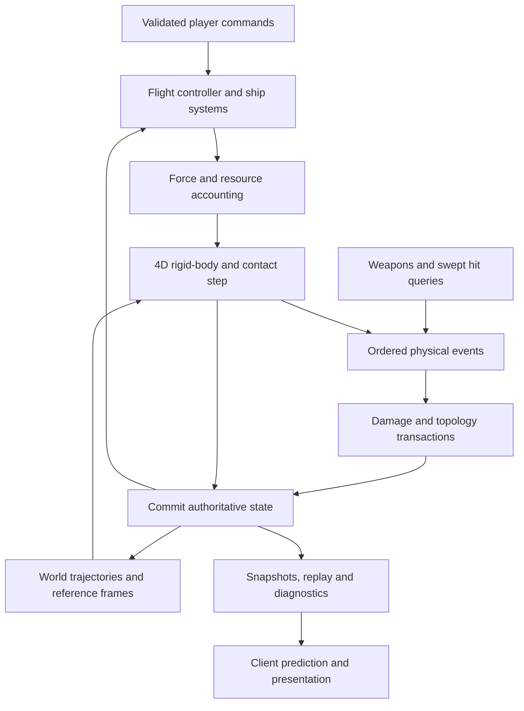

# Integrating the 4D space-sim systems

Status: **proposed architecture**, 2026-11-04. Companion to the [engine specification](SpaceSimSpecification.md). Existing types and mathematical conventions are identified explicitly; the scheduler, ship systems, region management and networking described here are future implementation work.

## Architecture and ownership

Use one authoritative simulation timeline and one owner for each mutable state. Separate systems by responsibility, but exchange time-stamped commands and results rather than letting each system independently move the same body.



The diagram shows data dependencies, not separate integrators. Weapon impacts that affect motion enter the physics event sequence before the step is committed.

| Owner | Authoritative state | Allowed interaction with other systems |
|---|---|---|
| Simulation coordinator | Tick, event order, pending commands, transaction boundaries | Schedules work and commits changes |
| Physics core | Body transforms, linear/angular velocity, mass properties, contacts | Consumes forces/impulses and emits motion/contact results |
| Ship systems | Component health, fuel, power, heat, actuator state | Requests actuation and submits validated mass/topology changes |
| World manager | Global location/frame metadata, trajectory tiers, spatial residency | Transfers bodies at boundaries and supplies environment queries |
| Combat | Weapon state, projectile identity, hit records | Schedules authoritative queries and physical impact events |
| Damage processor | Failure decisions and component connectivity | Consumes impact results and requests topology transactions |
| Network/replay | Input sequence, snapshots, history, protocol versions | Serializes committed state and submits validated commands |
| Renderer | Interpolated visual state, camera and 4D presentation | Reads snapshots; never writes authoritative physics state |

Physics may store velocities, as the current core does, and derive momentum using mass and inertia. Do not introduce separately editable momentum and velocity fields that can disagree. If the core later integrates momentum directly, make velocity derived and document the change at the API boundary.

## Coordinate and dynamics contract

Use consistent units for length, time and mass; annotate interfaces with coordinate frame, reference point and timestamp. Keep positions distinct from displacement vectors. All forces and lever arms in a calculation must be expressed in the same frame.

Current code conventions:

- `Vec4` is a spatial vector; `Lane4` is a SIMD utility, not a position.
- `Rotor` represents a Spin(4) rotation; `RMat44` includes translation, whereas `Mat44` is a 4×4 linear map.
- `Bivec` stores `[XY, XZ, XW, YZ, YW, ZW]`, followed by two padding lanes.
- For offset `r` from the center of mass, point velocity is `v + Omega.Contract(r)`.
- Orientation stepping uses `R_next = exp(0.5 * Omega * dt) * R` for the sampled angular velocity. This formula does not itself solve the evolution of `Omega` under gyroscopic dynamics.
- **Torque and angular impulse use `F ∧ r` and `J ∧ r`**, respectively. Orbital angular momentum about the origin is `p ∧ x` in this stored convention.

These signs follow the virtual-work identity:

```text
dot(F, Omega.Contract(r)) = dot(Omega, wedge(F, r))
L_origin = I_world(Omega) + wedge(p, x)
```

The common coordinate convention `r_i F_j - r_j F_i` has the opposite sign to this repository's stored torque components. Do not copy that formula into ship code without the convention conversion. Use the tested API and verify power, point velocity and impulses together. See [Bivec.h](../Jolt/Math/Bivec.h), [Body.inl](../Jolt/Physics/Body/Body.inl), and [DynamicsConventionsTest.cpp](../UnitTests/Physics/DynamicsConventionsTest.cpp).

A physical inertia operator is symmetric and positive for a nondegenerate mass distribution. In body principal coordinates its structure can be exploited; world-space application must include the current orientation. Keep gyroscopic coupling, rotor validity and angular-momentum conservation in the acceptance tests. Merely normalizing eight rotor components does not by itself establish membership in Spin(4).

## One authoritative step

Let committed state `S_n` describe time `t_n`, and advance to `t_n + h`. Start with a fixed `h`; make optional event substeps explicit and bounded. The following is a logical dependency order, not an instruction to run a second integrator around `PhysicsSystem::Update`.

1. **Accept commands and boundary transactions.** Validate sequence numbers and intended times; apply scheduled spawns, configuration changes and safe frame transfers. Inputs arriving after the cutoff follow the declared late-input policy.
2. **Prepare the interaction region.** Advance cheap trajectories to the same epoch, construct conservative swept bounds, and promote objects that could interact during this interval. Resolve ownership across local frames before detailed collision solving.
3. **Evaluate control and resources.** Controllers read the committed state and request actuator outputs. Resource limits determine actual delivered forces, consumption and heat. Identify depletion or other discontinuities that require splitting the interval.
4. **Prepare external forces and weapon events.** Aggregate thrust about the current center of mass, evaluate environmental fields, and launch projectiles with inherited point velocity and accounted recoil. Consume each force for its specified duration and each impulse once.
5. **Advance motion and resolve interactions.** The physics owner evaluates the force/integration scheme, broad/narrow phase, contact constraints and CCD. Collision trajectories must agree with the motion used by the integrator. For a motion-changing time-of-impact event, advance to that event, apply response, invalidate affected predictions and integrate the remainder.
6. **Process damage and topology at defined times.** Use actual contact/impact results. If a failure changes motion within the interval, process it at an event boundary and recompute the remaining interval. Otherwise schedule it for the next tick boundary and document that latency. Never remove bodies while parallel solver jobs still reference them.
7. **Commit once.** Finish mass/resource ledgers, update bounds and caches, validate finite state, record diagnostics, and publish a consistent snapshot for networking and rendering. No reader should see half a breakup or an old inertia tensor with a new mass.

The current Jolt update already owns integration and contact solving. A first prototype should feed that API and measure its errors. A more sophisticated within-tick event loop requires explicit core integration work; repeatedly calling `Update` with arbitrary fractions without auditing force clearing, solver iterations and callbacks is not a complete implementation.

## Different update rates without inconsistent physics

Use the authoritative tick as the common clock. For lower-rate systems, schedule on integer tick intervals where practical; use explicit timestamps and an accumulator for other rates. Rendering and network delivery remain independent.

| System | Proposed scheduling policy |
|---|---|
| Motion, collisions and fast actuators | Every physics tick; targeted event substeps when justified |
| Flight-control feedback | Every motion tick initially; reduce only after stability tests |
| Power, fuel and thermal models | Their own bounded-error rates, with per-tick actuation constraints and consumption accounting |
| Sensors and strategic behavior | Scheduled queries against a defined snapshot epoch |
| Distant trajectories | Evaluated on demand or on a slower schedule with conservative interaction bounds |
| Network snapshots | Independent rate; include authoritative tick and frame identifiers |
| Rendering | Interpolate or predict presentation state from snapshots |

Holding a slow subsystem's output constant between updates is an explicit approximation. Fast events such as fuel exhaustion, engine failure or power loss must invalidate that output promptly. Integrate resource consumption over actual delivered thrust; do not repeatedly debit an entire slow-system interval at every physics tick.

Do not hide resource or dynamics latency by increasing all systems to 2,000 Hz. BeamNG documents a default 0.5 ms physics step, but that is a property of its model and scheduling, not a universal target for vehicle simulation. [BeamNG timing documentation](https://documentation.beamng.com/beamng_tech/tools/cosimulationeditor/tight_coupling/).

## Propulsion, mass and momentum accounting

The ship controller produces actuator requests. Thruster models return actual forces, mounting offsets, resource use and modeled losses. For each interval, accumulate `sum(F)` and `sum(wedge(F, r))` using the current center of mass.

For constant mass, linear impulse gives `delta_p = F * dt`. Variable mass needs an explicit flux model: an engine expelling fuel transfers momentum to exhaust. Simply subtracting fuel mass while keeping an independently accumulated ship momentum is not a valid general rocket model. A lumped exhaust model is sufficient if its momentum and energy accounting are consistent with thrust; exhaust particles are optional.

Mass redistribution, expulsion and detachment are different transactions. An internal redistribution conserves total momentum but can change inertia and angular velocity. Expelled mass carries momentum away. Detached components become new objects. Never implement all three as an unqualified assignment to mass and inertia.

For a freely detached piece with no separation impulse, initialize its center-of-mass velocity from the parent's rigid motion:

```text
v_piece = v_parent + Omega_parent.Contract(x_piece - x_parent)
```

Initialize compatible orientation and angular velocity, partition mass/inertia without duplication, and verify total linear and angular momentum about one common origin. Apply separation impulses in equal and opposite pairs; account for explosives or stored elastic energy if breakup adds kinetic energy. Newly created collision geometry must not generate a spurious explosion from overlapping pieces.

Docking also needs an explicit model. A constrained connection needs a ported 4D joint; a rigid merge needs recomputed combined mass/inertia and velocities derived from conserved momentum. A rigid merge may dissipate relative kinetic energy; record it instead of silently claiming an elastic process. Neither feature is complete in the current v1 core.

## Collision, weapons and damage

Provide a common collision-query service for physics, weapons and sensors, with explicit geometry, collision layers, epoch and frame. A sensor's simplified visibility proxy must not silently become the authoritative weapon collider.

For moving projectiles, test relative trajectories of projectile and target over the same interval. A ray against the target's end-of-tick pose is not sufficient for all moving targets. Finite-radius projectiles need swept volumes; curved trajectories need bounded approximation or subdivision. Rotating hulls need conservative treatment too.

Choose one impact-response path per event:

- A projectile represented as a dynamic body receives its contact impulse from the physics solver. Damage reads that result.
- A query-based projectile generates a physical impact event. The event handler applies the modeled impulse once and accounts for absorbed, reflected or continuing projectile momentum.

Damage uses impact location, component identity and modeled energy transfer to determine failures. Do not apply an arbitrary extra impulse proportional to hit points after the solver already resolved the impact. Penetration, ricochet and explosions require explicit material/energy rules; a generic contact impulse does not determine all of them.

For simultaneous events, define stable tie-breaking and solve genuinely coupled contacts together where necessary. Parallel workers emit event records; a deterministic merge or ordered commit prevents callback timing from deciding who is destroyed first. Cap pathological CCD/event loops with a documented conservative fallback and telemetry, not silent missed hits.

## Large worlds and asteroid populations

Use global positions for residency and long-range queries, and local coordinates for contact solving. Start with nonrotating local frames whose reference velocities are constant over an interval:

```text
x_global(t) = origin_global(t) + x_local(t)
v_global(t) = velocity_frame + v_local(t)
```

Rebasing changes representation, not physical state. At a common epoch transform positions and velocities, then rebuild or transform affected caches and broad-phase bounds. Shifting only positions is insufficient when changing frame velocity. Introducing acceleration or rotation into the frame requires extra terms; defer that complexity until needed.

Objects that can exchange impulses must share a coherent solve. Merge interacting local regions or transform the entire interacting set into one solve frame. Avoid assigning one physical body to two independently advancing regions. Cross-region projectiles, sensor queries and pending contacts must survive migration with stable IDs and timestamps.

Use tiers based on interaction needs:

| Tier | State and obligations |
|---|---|
| Detailed | Full motion/contact processing for ships and relevant nearby objects |
| Trajectory | State propagated under a specified model; conservative swept bounds remain queryable |
| Distant population | Persistent identity and trajectory/seed sufficient to reconstruct state at an epoch; no unaccounted disappearance of consequential changes |

Promotion happens before the earliest possible interaction, with margin for scheduling delay. Hysteresis prevents repeated tier switching. Demotion requires no active contacts, unresolved impulses, imminent weapon interactions or topology transaction. Every transition preserves pose, momentum, health and relevant history.

If gravity is modeled as a prescribed external field, bodies exchange momentum with that external model; closed-system body-only conservation tests are inapplicable. Full mutual gravity is a different algorithm and scaling requirement. Choose the force law, sources and approximations explicitly before promising orbital behavior.

## Networking, prediction and replay

Clients send commands with sequence numbers and intended simulation times. The server validates control authority and timing, advances authoritative systems, and emits snapshots with acknowledgements. Never trust client transforms, hit reports or resource totals as authoritative state.

Snapshots and replay checkpoints must include sufficient causal state: body state, mass properties, component/resource state, actuator/controller state, frame identifiers, random seeds, pending events and topology versions. Exact restart may additionally require solver caches and scheduling state. Document whether a checkpoint reproduces exact future states or only converges within a tolerance.

Clients predict their own ship using matching model/configuration where practical, then reconcile from acknowledged server state and replay pending inputs. Apply visual smoothing to presentation, not by corrupting the authoritative momentum state. Remote ships can be interpolated; collision prediction against uncertain remote motion needs a declared correction policy.

For lag compensation, retain bounded historical geometry and state with original frames and timestamps. Resolve historical queries in an isolated view. Define how their outcomes become live events; do not inject an old impulse into today's state as though its application time were unchanged. Full rollback must restore and replay the coupled affected state, including resources and damage.

Replication interest differs from physics interest: an object outside a client's view may still block a shot or influence a collision. The server must preserve that interaction even if the client receives only a coarse representation.

## Parallelism, overload and diagnostics

Parallelize independent ships, spatial queries and contact islands. Force accumulation and event ordering must have stable ownership; uncontrolled floating-point reduction order can change results. Shared collision islands require a coordinated solver, not independent per-ship collision responses.

Keep simulation memory bounded with pools and declared limits on bodies, contacts, projectiles and fragments. Reserve resources or define failure behavior before committing a breakup. Report allocation failures and physics update errors as simulation failures, not successful steps.

Under load, shed optional presentation or low-priority sensing work first. Apply an explicit admission/debris policy before saturation. Do not silently drop time, skip authoritative collisions or reduce solver quality to preserve a displayed tick rate. If the declared workload cannot be maintained, expose backlog and invoke the chosen server overload policy.

Record per-stage time, candidate pairs, contacts, CCD events, body counts, allocations, conservation residuals, topology events, frame transfers, input corrections and network bytes. Use a common tick/event ID so a performance spike can be traced to a physical interaction.

## Integration gates

| Boundary | Required check |
|---|---|
| Controller → actuator | Requested versus achievable force; saturation and resource limits |
| Actuator → physics | Units, frame, lever arm, torque sign and impulse duration |
| Physics → damage | One impact ID, one response, consistent position/time and energy accounting |
| Damage → topology | Atomic ownership change, mass/inertia partition and conservation |
| World → local simulation | Same epoch, conservative activation and frame-invariant outcomes |
| Simulation → network | Consistent snapshot, stable IDs, versioned state and input acknowledgement |
| Prediction → presentation | Bounded correction without altering authoritative mechanics |

A useful first end-to-end acceptance sequence is: a fueled ship maneuvers through moving asteroids, fires, loses an off-center thruster, sheds a section, crosses a local-frame boundary, and reconciles after delayed network input. Check the seven requirements throughout, including event bursts. Passing each subsystem's unit tests alone does not establish that this sequence works correctly.
